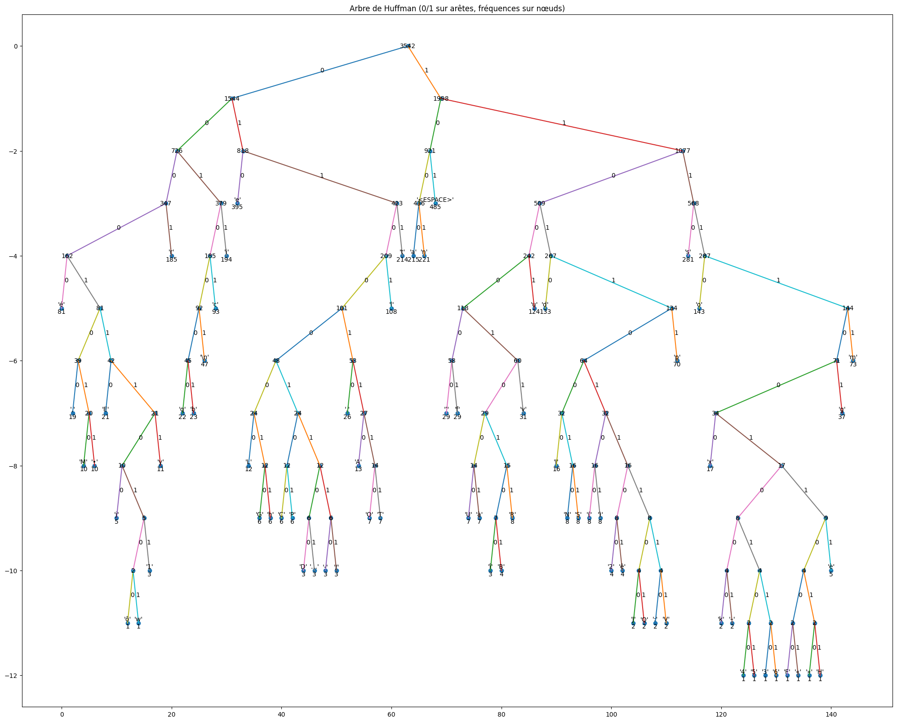

# Entropie & Codage de Huffman

Projet réalisé dans le cadre du **Master 2 Big Data** (Université Sorbonne Paris Nord – Paris 13) par **Philippe Roumbo**.

L'objectif est d'appliquer des notions de **théorie de l'information** à un texte réel : la présentation du parcours *Big Data, Analyse et Business Intelligence* publiée sur le [site de l'UFR](https://ecogestion.univ-paris13.fr/parcours-big-data-analyse-et-business-intelligence/).

## Contenu du projet

Le notebook [`Entropie_Huffman_ROUMBO_PHILIPPE_M2Bigdata.ipynb`](Entropie_Huffman_ROUMBO_PHILIPPE_M2Bigdata.ipynb) traite trois questions :

1. **Calcul de l'entropie du texte**
   - Entropie de Shannon sur les caractères : `H = -Σ p·log₂(p)`
   - Entropie conditionnelle sur les bigrammes : `H(Y|X)`
   - Entropie sur les mots
   - Pour chaque cas : perplexité (`2^H`), taille de l'alphabet / du vocabulaire et entropie normalisée (`H / log₂|A|`)
2. **Codage de Huffman**
   - Construction de l'arbre avec une file de priorité (`heapq`)
   - Extraction du dictionnaire de codes (gauche = `0`, droite = `1`)
   - Longueur moyenne du code et taux de compression
3. **Représentation de l'arbre de Huffman**
   - Aperçu ASCII de l'arbre
   - Dessin complet avec `matplotlib`

## Résultats

### Entropie

| Type                   | Entropie (bits) | Perplexité | Alphabet / Vocab | Normalisée |
|------------------------|----------------:|-----------:|-----------------:|-----------:|
| Caractère              | 4.5764          | 23.86      | 73               | 0.739      |
| Caractère conditionnel | 3.1583          | 8.93       | 73               | 0.690      |
| Mot                    | 7.3766          | 166.18     | 273              | 0.912      |

Connaître le caractère précédent fait baisser l'incertitude sur le suivant de 4.58 à 3.16 bits.

### Codage de Huffman

| Indicateur                                 | Valeur                  |
|--------------------------------------------|-------------------------|
| Nombre de caractères                       | 3 542                   |
| Taille de l'alphabet                       | 73                      |
| Longueur moyenne                           | **4.5946 bits/symbole** |
| Taille compressée                          | 16 274 bits             |
| Taux vs codage fixe (7 bits/symbole)       | 0.6564 (gain **34.36 %**) |
| Taux vs 8 bits/caractère                   | 0.5743 (gain **42.57 %**) |

La longueur moyenne (4.59 bits) est très proche de l'entropie du texte (4.58 bits), qui est la borne inférieure théorique : `H ≤ L < H + 1`.

Extrait du dictionnaire (caractères les plus fréquents) :

| Caractère | Fréquence | Probabilité | Code    |
|-----------|----------:|------------:|---------|
| `espace`  | 485       | 0.1369      | `101`   |
| `e`       | 395       | 0.1115      | `010`   |
| `s`       | 281       | 0.0793      | `1110`  |
| `n`       | 221       | 0.0624      | `1001`  |
| `a`       | 215       | 0.0607      | `1000`  |
| `t`       | 214       | 0.0604      | `0111`  |
| `i`       | 194       | 0.0548      | `0011`  |
| `r`       | 185       | 0.0522      | `0001`  |

### Arbre de Huffman



## Lancer le projet

```bash
git clone https://github.com/filou337/Entropie_Huffman.git
cd Entropie_Huffman
pip install -r requirements.txt
jupyter notebook Entropie_Huffman_ROUMBO_PHILIPPE_M2Bigdata.ipynb
```

Le notebook peut aussi être ouvert directement dans Google Colab.

## Technologies

- Python 3
- pandas, NumPy
- matplotlib
- `collections.Counter`, `heapq`, `math` (bibliothèque standard)

## Auteur

**Philippe Roumbo** – Master 2 Big Data, Université Sorbonne Paris Nord
